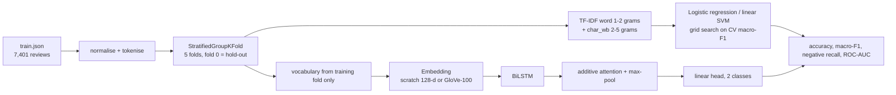
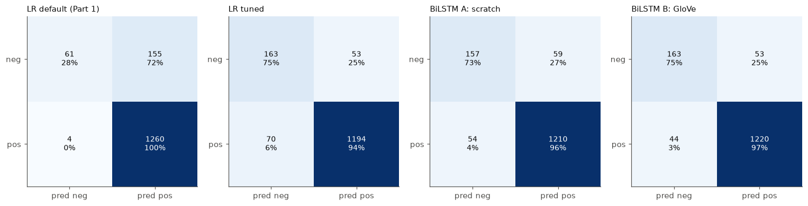
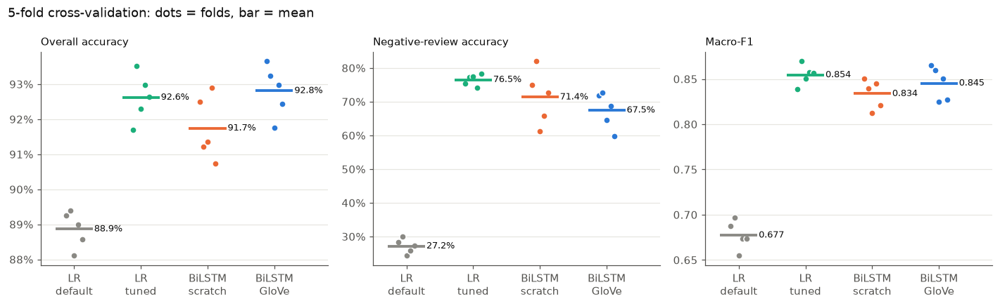

# Product-Review Sentiment Classification: TF-IDF Baselines vs an Attention BiLSTM

Binary sentiment classification of product reviews. Tuned TF-IDF linear models are compared with a bidirectional LSTM
with additive attention, trained from scratch and with GloVe embeddings. Validation uses near-duplicate-aware splits.

*Coursework project for IE4483.*

## Problem
The course dataset has 7,401 labelled reviews, 85.4% of them positive. On data this imbalanced, accuracy hides how well
a model finds negative reviews, and duplicate reviews make validation optimistic when copies land on both sides of a
split. The goal is a fair comparison of classical and neural models: macro-F1 and negative-class recall are tracked
alongside accuracy, and splits keep duplicates together.

## Objectives
1. Build a reproducible TF-IDF baseline, then tune it: word and character n-grams, class weights, LR vs linear SVM.
2. Train a BiLSTM classifier with attention, from scratch and with pretrained GloVe-100 embeddings, over several seeds.
3. Compare all models on one hold-out fold plus 5-fold cross-validation, with leakage-safe splits.

## Key features
- **Leakage-safe validation.** `StratifiedGroupKFold` groups reviews by normalised text (case, whitespace and
  punctuation removed), so near-duplicates never cross a train/validation boundary. The split code also asserts
  this.
- A tokeniser that keeps sentiment cues: negations, "don't"-style contractions, and "!"/"?" as tokens.
- An attention BiLSTM: additive attention concatenated with max-pooling, packed sequences, and masking so padding
  never affects the output (tested).
- Results across 3 seeds (mean ± sd), plus a 3-seed ensemble.
- TF-IDF runs are logged with their config and metrics (`results/training_log.csv`); the BiLSTM runs are cached
  in `results/bilstm_runs.pkl` and summarised in `results/model_comparison.csv`.

## Architecture


## Technologies
Python, scikit-learn (TF-IDF, LR, LinearSVC, StratifiedGroupKFold), PyTorch (BiLSTM; Apple MPS, CUDA or CPU), pandas,
Matplotlib, GloVe-100 (glove-wiki-gigaword-100, downloaded through gensim-data), pytest.

## Project structure
```
├── Sentiments_Project_IE4483/Code/
│   ├── IE4483_all_models.ipynb   # the full study: TF-IDF, BiLSTM scratch + GloVe, seeds, ensembles, CV, figures
│   ├── tfidf_baseline.ipynb      # the Part 1 baseline on its own
│   ├── bilstm_model.ipynb        # the BiLSTM part on its own
│   └── Packages/                 # shared code: loading, preprocessing, grouped splits, metrics, TF-IDF grid search
├── results/                      # metrics only (no review text): comparison, CV, sweeps, training log
├── report_figures/               # figures used in the write-up
└── tests/                        # pipeline tests on synthetic data
```
`Packages/train_bilstm.py` is an earlier script version of the BiLSTM (mean and max pooling, no attention). The
reported BiLSTM results come from the attention model in the notebooks.

## Installation
```bash
python3.14 -m venv .venv && source .venv/bin/activate
pip install -r requirements-dev.txt
mkdir -p data && cp /path/to/course/train.json /path/to/course/test.json data/   # course data, not in this repo
```
`IE4483_DATA` and `IE4483_RESULTS` can point the code at other folders.

## Running
```bash
cd Sentiments_Project_IE4483/Code/Packages
python -c "import train_tfidf; train_tfidf.main()"   # TF-IDF grid search (128 configs, 5-fold CV) + hold-out scores
cd .. && jupyter lab IE4483_all_models.ipynb         # full study; GloVe-100 downloads on first run
pytest                                               # from the repo root; synthetic data, about 2 s
```

## Results
All rows are scored on the same hold-out fold (fold 0, 1,480 reviews). Source: `results/model_comparison.csv`, with
the SVM row from `results/training_log.csv`.

<!-- results-table -->
| Model | Accuracy | Macro-F1 | Negative recall |
|---|---|---|---|
| TF-IDF + LR (default) | 0.8926 | 0.6874 | 0.2824 |
| TF-IDF + LR (tuned) | 0.9169 | 0.8385 | 0.7546 |
| TF-IDF + linear SVM (tuned) | 0.9270 | 0.8536 | 0.7500 |
| BiLSTM-attention, scratch (3 seeds) | 0.9198 ± 0.0048 | 0.8408 ± 0.0094 | 0.7377 ± 0.0175 |
| BiLSTM-attention, GloVe (3 seeds) | 0.9284 ± 0.0081 | 0.8559 ± 0.0100 | 0.7485 ± 0.0271 |
| BiLSTM-attention, GloVe, 3-seed ensemble | 0.9345 | 0.8662 | 0.7546 |
<!-- results-table -->

What the numbers say:
- Tuning matters more than the model family. Default TF-IDF + LR finds only 28% of negative reviews; class weights
  and character n-grams raise that to 75%.
- GloVe initialisation helps the BiLSTM: +0.9 accuracy points over training from scratch on the seed means.
- The 3-seed GloVe ensemble is the best model. The tuned linear SVM is close behind at a fraction of the cost (0.3 s
  of training).

| Confusion matrices | Cross-validation |
|---|---|
|  |  |

**Reproduction check (2026-11-18).**
- Re-running `train_tfidf.main()` gives an identical 128-row CV grid, the same best configurations, and the same
  hold-out scores (LR 0.9169 / 0.8385, SVM 0.9270 / 0.8536).
- The BiLSTM runs were not re-run in this cleanup. Their numbers are the committed results of the original notebook
  runs.
- `tfidf_baseline.ipynb` (the Part 1 baseline, with its own tokenisation) ran end to end on the course data (31 cells,
  no errors), giving 0.8932 accuracy and 0.6980 macro-F1 on the hold-out. The table's default row is the shared
  pipeline in `Packages/` (0.8926 / 0.6874, `training_log.csv`).

## Limitations
- One dataset and one hold-out fold for the main comparison. CV scores are in `results/cv5_all_models.csv`.
- With about 1,000 negative reviews, differences under about 1 point are within seed-to-seed spread (see the ± values).
- The original training environment was not recorded. `requirements.txt` pins the versions this cleanup was verified
  with.
- The course data is not redistributable, so the results can only be reproduced with access to it.

## Future work
A transformer baseline (e.g. DistilBERT) on the same splits; calibration of the probability outputs; error analysis of
negation and sarcasm cases.

## References
1. Pennington, J., Socher, R., Manning, C. (2014). GloVe: Global Vectors for Word Representation. *EMNLP*.
2. Hochreiter, S., Schmidhuber, J. (1997). Long Short-Term Memory. *Neural Computation* 9(8).
3. Bahdanau, D., Cho, K., Bengio, Y. (2015). Neural Machine Translation by Jointly Learning to Align and Translate.
   *ICLR* (additive attention).
4. Pedregosa, F. et al. (2011). Scikit-learn: Machine Learning in Python. *JMLR* 12.
